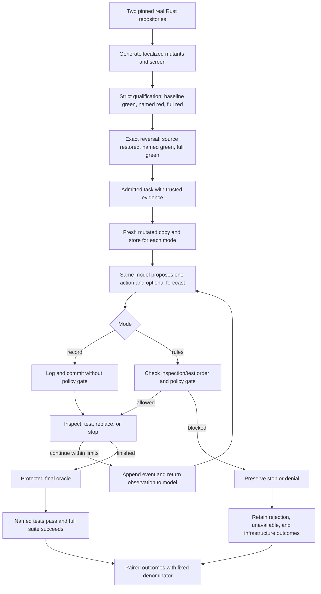

# What the current M3 experiment tests

This is a paired test of **recording versus enforcing fixed controller rules** on bounded code-repair tasks. It is not yet a test of the complete evolving TSR architecture.

## Task provenance and admission

The source is real Rust code from pinned RTS (`308a5e74298254e4282c5c2952259be3bbfe62b2`) and AgentID (`c0badb6b10001e74a554ff59fc646ece8a1f7ee3`) repositories. Bugs are deliberately generated by cargo-mutants; these are real-code mutation tasks, not naturally occurring bug reports. A targeted screen finds mutants caught by tests. Screening alone does not admit a task.

Strict admission independently checks: original full suite green; exactly one production Rust function changed; each named test actually runs and fails; mutated full suite fails; exact reversal restores original source and file inventory; each named test passes; full suite green again. Task/function identities, preparation and evidence are retained. The reversal is an admission control and remains hidden from the repair model. A repair need not reproduce that reversal, provided the protected oracle accepts it.

References: `crates/tsr-corpus/src/mutants.rs`; `crates/tsr-batch/src/admission.rs:84` (`qualify_one`), especially lines 213–277.

## Matched systems

Each task gets separate disposable copies and fresh per-mode stores. Both use `deepseek-v4.1-flash` through `api.cheaperinference.com`, the same prompt, source scope, named test, engine and broker. Each arm permits 200,000 billed generator tokens, 20 generator calls, 15 accounted tool minutes, 1,800 driver wall seconds, and 131,072 cumulative replacement bytes. Provider output is capped at 16,384 tokens. These are caps, not promised consumption. Final oracle/provisioning time is outside the driver wall timer.

| Mode | Actual behavior |
| --- | --- |
| record | Records candidate, optional forecast, commitment, observations and executions; commits without policy gate. Common containment, scope and hard budgets still apply. |
| rules | Same loop, plus all required source inspections before a test, designated test execution before replacement, and profile/grant/forecast/budget policy gate before commitment. |

The designated test need only be attempted to set the driver's `tested` flag; the live rule does not independently require its exit to be failing. Admission previously established the failure. A rule-order violation ends the attempt. Policy denial ends model iteration; the batch may still judge the resulting copy. There is no alternate-candidate search after denial.

References: `crates/tsr-batch/src/broker.rs:138` (`drive`), lines 262–318; `session.rs:211` (`commit`) and 256 (`commit_ungated`); `crates/tsr-policy/src/gate.rs:160` (`evaluate`); `scripts/m3-paired-cohort.py`; `docs/m3-paired-cohort-1-plan.json`.

## What the TSR concepts actually mean here

- **Desire:** operationally, a fixed repair objective and acceptance criteria. The broker sees failing-test identities and a repair instruction. This path does not evolve a preference/desire store.
- **Intuition:** one model-generated proposal at a time (`inspect`, `test`, `replace`, `stop`), tagged `Source::Generator`. The domain's preference/tension Council composition is not invoked.
- **Belief/action selection:** commit that single proposal if permitted; no competing candidates or learned expected-value ranking. Both commit functions record placeholder utility values (`p_success=1`, `value=1`, `cost=0`, `ev=1`, propensity 1).
- **Expectation:** the model may supply a probability for `task_accepted_in_budget@v1`; it is recorded before commitment. Rules require a current candidate/state forecast for gated actions. The probability does not authorize the action or train a model. This loop does not resolve residuals or recalibrate from the final verdict.
- **Feedback/update:** append-only events advance the state root/version. Source contents, test output and prior action history go into the next model request. The model can revise code within the same task. There is no weight update, trained head invocation, preference expansion, emotional feedback, long-lived cross-task memory or final-oracle repair retry.

References: `broker.rs:170–194,282–308,326–386`; `session.rs:163,211,256`; `run.rs:295–338` (fresh store); domain Council/Culmination interfaces exist at `crates/tsr-domain/src/lib.rs:992` but are not called by this driver. Relevant runtime files are unchanged from frozen engine source commit `3453084`.

## Judgment and reporting

The trusted controller keeps evidence independent of candidate changes. It rejects protected test/build/module tampering, checks before and after test execution, requires every named test to run and pass (zero matched tests cannot count), and requires full-suite success. Evaluated commands run in sealed restricted containers. Candidate tests cannot approve their own patch merely by emitting a success assertion.

Record accepted/rejected, unavailable/provider/protocol failures, budget or order-rule stops, integrity rejections, and process/infrastructure errors separately. Preserve every attempt. Report acceptance yield with the full predeclared denominator, observed complete pairs, and paired discordances. Pilot attempts remain separate. Zero-duration reporting on some paths prevents trustworthy latency comparisons. Two lineages and small samples do not establish broad performance gains.

References: `run.rs:487–589`, `protected_oracle` at 1002, `run_oracle_tests` at 1238, `oracle_verdict` at 1277; `scripts/m3-paired-cohort-evidence.py`.

## Flow

The diagram simplifies terminal handling: order/budget stops bypass final oracle; a policy denial ends the driver but can proceed to final oracle. No arrow feeds the final verdict into model training or a new repair attempt.

## Current status and larger plan

At inspection, 38 tasks are admitted (18 AgentID, 20 RTS). Ten further RTS candidates completed screening in 11.34 minutes and are qualifying with two workers. Four AgentID qualifications with known terminal receipts took 9.84–12.01 minutes each (median 10.93); two reconciled unknown process exits are excluded from this duration estimate. The approved four-task/eight-arm cohort is waiting for current qualification; no new paid calls have begun. Cumulative cost is $0.045569. Free disk was 333 GiB, above the 100 GiB stop floor.

The next planning snapshot covers **32 additional tasks / 64 arms**: all 38 existing admissions minus two legacy pilot tasks and four already allocated tasks. Every omission has an ID and reason in `m3-expanded-evaluation-proposal.json`. New admissions belong in a new versioned snapshot after qualification. There is no scientific four-task limit; four was a runner checkpoint. Recommend all remaining eligible tasks, serialized paid execution with per-arm charge reconciliation, rather than more arbitrary four-task samples. First confirm checkpoint terminal integrity, per-task input-size compatibility, disk forecast and explicit expanded disclosure authorization.

Preserve existing RTS/train and AgentID/holdout labels and report partitions separately. The split audit already explicitly says this is an integrity diagnostic, not an untouched reserved holdout; pilot exposure must not be relabeled as confirmatory validation. Do not tune from holdout outcomes, move tasks across boundaries or pool legacy pilots. Any final confirmatory holdout protocol needs its own frozen access/analysis plan.

M3 acceptance remains unmet: fewer than 150 admissions and insufficient paired performance/tension evidence. The larger plan is prepared only; it does not authorize or launch paid work.
